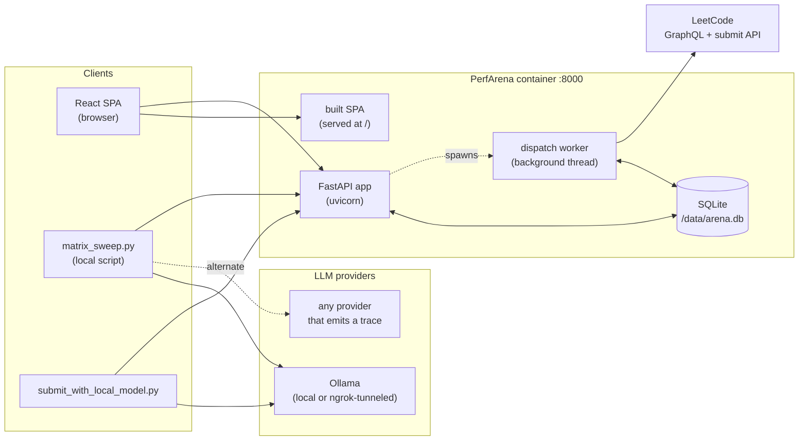
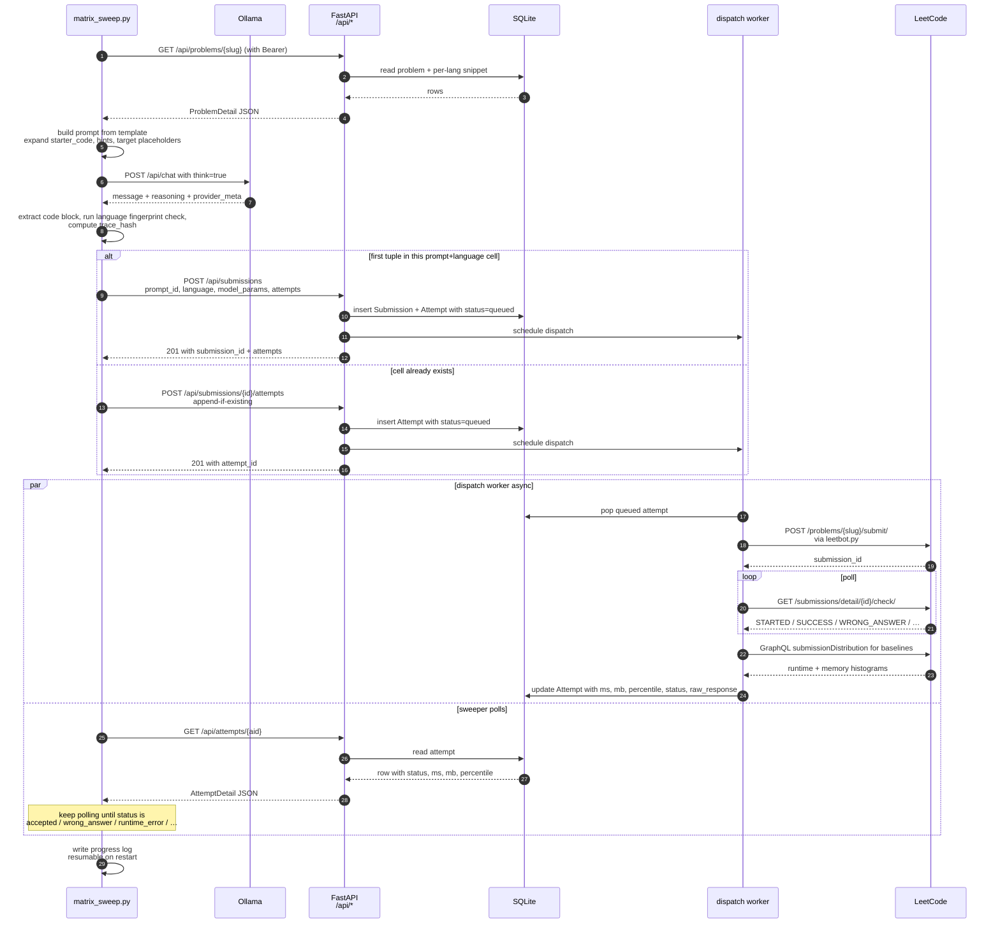
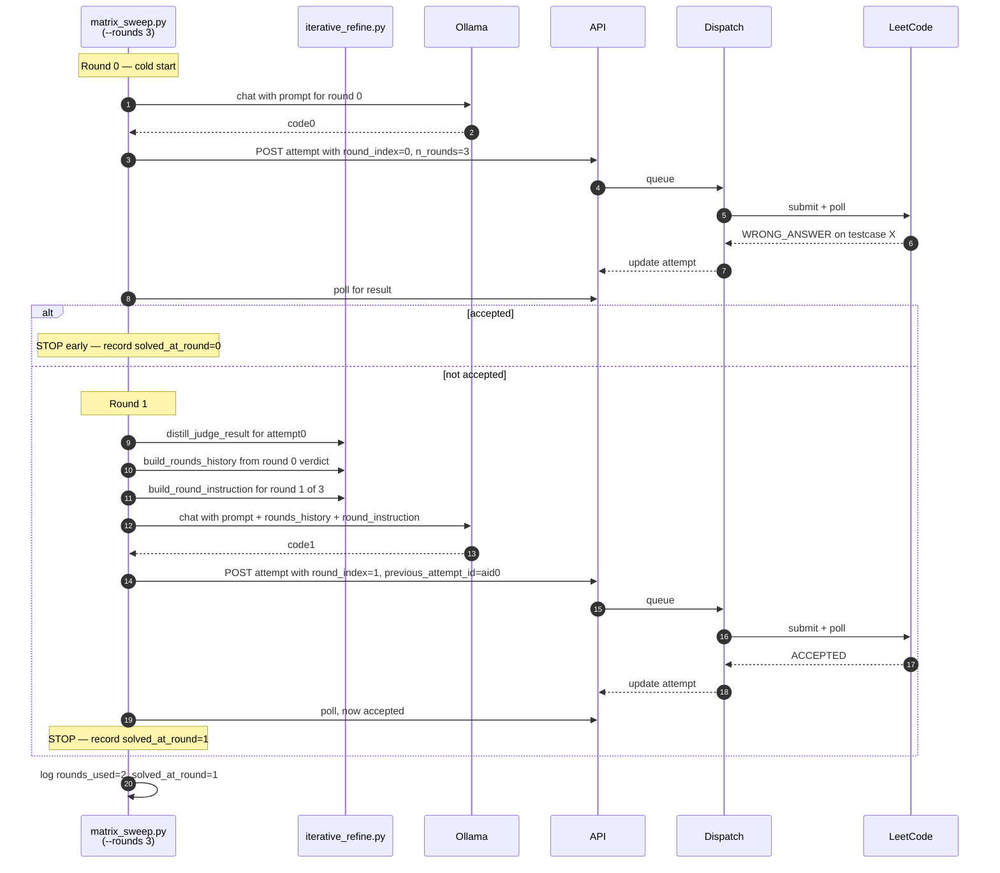
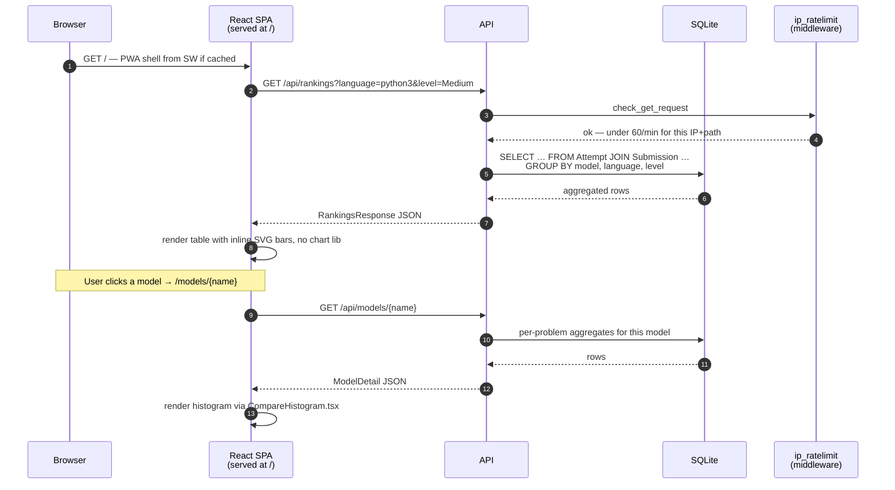
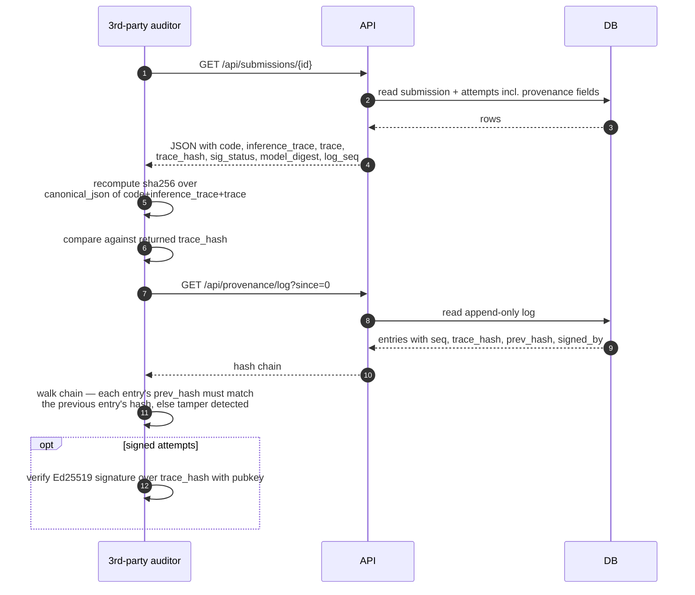

# PerfArena

> An open competition platform for benchmarking LLM code generation on LeetCode problems — with verifiable, real-judge results.

PerfArena lets AI labs (and individuals) submit batches of model-generated solutions for a curated set of LeetCode problems. Each solution is dispatched to **the real LeetCode judge** to capture runtime, memory, and percentile metrics, then ranked by language, problem, difficulty, and prompt strategy. The provenance of every attempt — prompt, raw model response, reasoning trace, model digest, optional Ed25519 signature — is anchored in an append-only hash chain so reviewers can verify what was actually produced.

Built at **NYU Abu Dhabi** by Rui Rua, Hailemarian Mersha, Karim Ali (SanadLab), and João Paulo Fernandes. Licensed **Apache 2.0**.

> ⚠ **About LeetCode percentiles** — LC's per-run runtime/memory percentile is observably noisy (~4 pp within-attempt spread; ~50 % rank agreement with raw ms across attempts). PerfArena shows best-of-N with mean alongside instead of a single noisy run. Full empirical analysis: [`docs/leetcode-percentile-semantics.md`](docs/leetcode-percentile-semantics.md).

---

## Table of contents

1. [Repo layout](#repo-layout)
2. [Architecture](#architecture)
3. [End-to-end workflows (sequence diagrams)](#end-to-end-workflows)
   - [Population: matrix sweep → ranked leaderboard](#population-matrix-sweep--ranked-leaderboard)
   - [Iterative refinement (multi-round) sweep](#iterative-refinement-multi-round-sweep)
   - [Read path: user opens the leaderboard](#read-path-user-opens-the-leaderboard)
   - [Provenance verification](#provenance-verification)
4. [Installation](#installation)
   - [Quick start with Docker (recommended)](#quick-start-with-docker-recommended)
   - [Local development](#local-development)
5. [Running stuff](#running-stuff)
6. [Configuration (env vars)](#configuration-env-vars)
7. [Testing](#testing)
8. [Contributing](#contributing)
9. [Further reading](#further-reading)

---

## Repo layout

```
leetcode_crawler/
├── README.md                       # ← this file
├── Dockerfile                      # single-container build (frontend + backend)
│
├── prepare_dataset.py              # HF parquet → data/problems.parquet + data/solutions.parquet
├── sample_solutions.py             # pick top-N problems per difficulty, dump solutions
├── leetbot.py                      # one-shot LeetCode submitter (imported by backend dispatch)
├── train-00000-of-00001.parquet    # raw HF dataset (34,903 rows; 1,853 problem ids)
│
├── data/                           # canonical reference data (also baked into container)
│   ├── problems.parquet            # 1,973 deduped problems
│   ├── solutions.parquet           # 4,391 extracted code blocks
│   ├── sampled_problems.json       # the 99 slugs the platform ships with
│   ├── baselines/                  # per-(slug, lang) human anchors for percentile recalibration
│   ├── runs.jsonl                  # local append-only log from one-shot leetbot.py runs
│   └── test_submissions/           # hand-written smoke-test solutions
│
├── sampled_solutions/              # human reference solutions per (slug, lang)
│
├── docs/
│   ├── leetcode-percentile-semantics.md   # empirical analysis of LC percentile noise
│   └── problem-selection.md               # how the 99-problem benchmark set was chosen
│
└── webapp/
    ├── backend/                    # FastAPI + SQLModel + SQLite
    │   ├── app/
    │   │   ├── main.py             # FastAPI app, routes, startup hooks (seeders, bootstrap admin)
    │   │   ├── db.py               # engine + additive-only migrations (`_ADDITIVE_COLUMNS`)
    │   │   ├── models.py           # SQLModel tables (User, Submission, Attempt, …)
    │   │   ├── schemas.py          # Pydantic response shapes
    │   │   ├── auth.py             # API-key + password auth, hashing, key gen
    │   │   ├── dispatch.py         # async LeetCode dispatch worker, baseline refresh
    │   │   ├── baselines.py        # per-(slug, lang) anchor lookup + ms↔percentile recalibration
    │   │   ├── leetcode_dist.py    # GraphQL queries to LC's distribution endpoints
    │   │   ├── populate.py         # fake-data seeder for local dev
    │   │   ├── seed.py             # imports problems.parquet + bootstraps admin
    │   │   ├── provenance.py       # SHA-256 hash chain + Ed25519 signature verification
    │   │   ├── export_import.py    # admin: dump/restore full DB as JSON
    │   │   ├── ratelimit.py        # per-user submission cooldown + daily cap
    │   │   ├── ip_ratelimit.py     # per-(IP, endpoint) GET rate limit (60/min default)
    │   │   ├── snapshot.py         # weekly point-in-time leaderboard snapshots
    │   │   ├── validation.py       # language conformance fingerprinting
    │   │   └── …                   # one-off scripts (fix_*, rank_*, measure_*)
    │   └── tests/                  # 152+ pytest tests, including coverage of every endpoint
    │
    ├── frontend/                   # Vite + React 18 + TypeScript PWA
    │   └── src/
    │       ├── pages/              # Home, Rankings, Problems, ProblemDetail, Compare,
    │       │                       # Submissions, SubmissionDetail, AttemptResults,
    │       │                       # Submit, SubmitProgress, Me, Login, Register, ApiKey,
    │       │                       # Catalog, ModelDetail, SubmitterDetail, LanguageDetail,
    │       │                       # MyByLanguage, Competitions, CompetitionDetail,
    │       │                       # Prompts, Snapshots, SnapshotDetail, Admin, AdminExport,
    │       │                       # Blog, BlogPost, CorrectnessVsPerformance, About
    │       ├── components/         # Layout, CompareHistogram, RunsChart, AttemptsTable,
    │       │                       # SubmissionsTable, AuditPanels, Markdown, Th, …
    │       ├── lib/                # api.ts (typed fetch wrappers), format.ts, theme.ts
    │       ├── App.tsx             # router
    │       └── main.tsx            # entry + PWA registration
    │
    └── examples/                   # API clients & sweepers
        ├── submit_with_local_model.py   # single-shot Ollama → PerfArena demo
        ├── matrix_sweep.py              # multi-prompt × language × problem sweep (this is the workhorse)
        └── iterative_refine.py          # multi-round refinement helpers (used by matrix_sweep)
```

---

## Architecture

PerfArena is a **single-container web app** (FastAPI serves both `/api/*` and the built React SPA) with a **persistent SQLite database** and an **async dispatch worker** that calls LeetCode through `leetbot.py`. External population scripts (`matrix_sweep.py`, `submit_with_local_model.py`) talk to the same public HTTP API real users do.



**Key boundary properties:**

- **`/api/*`** is the **only contract** between population scripts and the platform. The sweep doesn't touch the DB; the DB doesn't touch the LLM.
- **Dispatch is async** — `POST /api/submissions/{id}/attempts` returns immediately with `queued`/`dispatching`; results land via polling `GET /api/attempts/{aid}`.
- **Migrations are additive-only** — `db.py:_ADDITIVE_COLUMNS` adds new columns on boot, never drops data. Re-deploys preserve the DB.
- **Rate limiting** has two layers: per-(IP, endpoint) GETs (default 60/min, see `ip_ratelimit.py`) and per-user submission cooldown + daily cap (see `ratelimit.py`).
- **Provenance** is a SHA-256 hash chain (`provenance.py`) of `(code, inference_trace, trace)`; clients can optionally Ed25519-sign each leaf.

---

## End-to-end workflows

### Population: matrix sweep → ranked leaderboard

Single-shot mode (`--rounds 1`, the default). Each `(prompt, language, problem)` tuple is one attempt.



After every attempt resolves, aggregates are derived on read:

- **Per-attempt aggregate** — `best_runtime_ms`, `best_memory_mb`, `best_runtime_percentile`, etc. over its retries.
- **Leaderboard** — `pass@k`, mean best runtime, mean best memory, mean best percentile, per (model, language, level).
- **Per-problem comparison** — bar widths scaled as `(min / value) × track_width` so the winner fills the track; bigger bar = better on every metric.

### Iterative refinement (multi-round) sweep

`--rounds N` (N>1) uses the `iterative-refine[-with-history][-with-shape]` prompt family. Round 0 is the cold attempt; rounds 1..N-1 are generated with `{{rounds_history}}` containing the previous judge verdict.



**Why rounds aren't just pass@k:** pass@k samples k *independent* tries from the same prompt; rounds give the model the *judge's verdict on the previous try* so the next attempt can debug. The taxonomy lives in `iterative_refine.py` and is surfaced on the leaderboard as `solved_at_round` and `rounds_used`.

### Read path: user opens the leaderboard



### Provenance verification

Anyone can recompute the trace hash and walk the chain to detect tampering:



`canonical_json` is `json.dumps(obj, sort_keys=True, separators=(",",":"), ensure_ascii=False)` — reproduce it exactly or the hash won't match.

---

## Installation

### Quick start with Docker (recommended)

The single-container image bakes the frontend, backend, reference data, and migrations. SQLite lives on a volume so the DB survives upgrades.

```bash
git clone https://github.com/sanadlab/perfarena.git
cd perfarena
docker build -t perfarena .

docker run -p 8000:8000 \
  -v perfarena-data:/data \
  -e ARENA_BOOTSTRAP_ADMIN_EMAIL=you@example.com \
  -e ARENA_BOOTSTRAP_ADMIN_PASSWORD='set-a-real-one' \
  perfarena
```

Open <http://localhost:8000>. The bootstrap creates an approved admin user on first boot; the auto-generated API key is printed to stderr (visible via `docker logs <container>`). Subsequent boots with the same email are no-ops.

To **enable real LeetCode dispatch** (off by default — the container ships in fake-judge mode so it works offline), also pass:

```bash
  -e ARENA_DISPATCH_ENABLED=1 \
  -e LEETCODE_COOKIE_HEADER='cookie1=…; cookie2=…' \
```

See `.env.example` for the cookie shape.

### Local development

For iterating on backend or frontend code without Docker:

```bash
git clone https://github.com/sanadlab/perfarena.git
cd perfarena

# ---- backend ----
cd webapp/backend
python -m venv .venv && source .venv/bin/activate
pip install -r requirements.txt
python -m app.seed                  # imports problems.parquet, seeds default prompts
uvicorn app.main:app --reload       # http://localhost:8000  (API docs at /docs)

# (optional) seed fake competitors so the leaderboard isn't empty
python -m app.populate

# ---- frontend ----
cd ../frontend
npm install
npm run dev                         # http://localhost:5173  (proxies /api → :8000)
```

Sign in with the admin API key (paste into Register → "already have a key?" or the `/me/api-key` page).

---

## Running stuff

### Submit one solution from a local LLM

```bash
export ARENA_API_KEY=arena_…
python webapp/examples/submit_with_local_model.py \
  --base-url http://localhost:8000 \
  --slug two-sum --language python3 \
  --ollama-url http://localhost:11434 --model qwen2.5-coder:7b
```

### Sweep many (prompt × language × problem) tuples

```bash
export ARENA_API_KEY=arena_…
python webapp/examples/matrix_sweep.py \
  --base-url http://localhost:8000 \
  --ollama-url http://localhost:11434 \
  --models qwen2.5-coder:7b,deepseek-coder:6.7b \
  --languages python3,cpp \
  --slugs two-sum,merge-intervals \
  --prompts baseline-2025q4,baseline-with-shape \
  --inter-problem-delay 60 --inter-tuple-delay 5
```

Add `--rounds 3` to enable iterative refinement (the script auto-picks the matching prompt family).

The sweep is **resumable** — kill it and re-run; the progress log skips completed tuples.

### Run a population batch from the legacy one-shot path

```bash
python leetbot.py two-sum python3 data/test_submissions/two-sum.py
# → appends a line to data/runs.jsonl
```

This bypasses the platform; useful for smoke-testing LeetCode auth.

---

## Configuration (env vars)

### Container / runtime

| var | default | purpose |
|-----|---------|---------|
| `ARENA_DB` | `webapp/backend/arena.db` (`/data/arena.db` in Docker) | SQLite path |
| `ARENA_SERVE_FRONTEND_DIR` | unset (Docker: `/app/web`) | Serve the SPA at `/` from this dir |
| `ARENA_IP_RATE_LIMIT_ENABLED` | `1` | Toggle per-(IP, endpoint) GET cap |
| `ARENA_IP_RATE_LIMIT_PER_MIN` | `60` | Cap value |
| `ARENA_IP_RATE_LIMIT_WINDOW_S` | `60` | Window length |
| `ARENA_TRUST_PROXY` | `0` | Honour `X-Forwarded-For` (only when behind a trusted proxy) |
| `ARENA_BOOTSTRAP_ADMIN_EMAIL` | unset | Create an admin on first boot (idempotent) |
| `ARENA_BOOTSTRAP_ADMIN_NAME` | `Admin` | Display name |
| `ARENA_BOOTSTRAP_ADMIN_API_KEY` | auto | Use this exact key; else one is generated |
| `ARENA_BOOTSTRAP_ADMIN_PASSWORD` | unset | If set, also enables `/login` for that user |

### Dispatch

| var | default | purpose |
|-----|---------|---------|
| `ARENA_DISPATCH_ENABLED` | `0` | `1` → real LeetCode; else fake judge |
| `ARENA_DISPATCH_INTER_DELAY` | `12` | Seconds between LC submits within one batch (±20% jitter) |
| `ARENA_DISPATCH_MAX_RETRIES` | `4` | Retries with exponential backoff on 429 |
| `ARENA_DISPATCH_SUBPROC_TIMEOUT` | `180` | Per-attempt subprocess timeout |
| `LEETCODE_COOKIE_HEADER` | — | Full `Cookie:` header (required for real dispatch) |
| `LEETCODE_SESSION` + `LEETCODE_CSRF_TOKEN` | — | Alternative to the header |
| `LEETCODE_HOST` | `https://leetcode.com` | Set to `https://leetcode.cn` for the China site |

### Submission limits

| var | default | purpose |
|-----|---------|---------|
| `ARENA_SUBMIT_COOLDOWN_S` | `600` | Min seconds between batches per user |
| `ARENA_SUBMIT_DAILY_CAP` | `5` | Max batches per rolling 24h per user |

Backend reads `webapp/backend/.env` at startup via `python-dotenv`.

---

## Testing

```bash
cd webapp/backend
pytest                              # 152+ tests; runs offline (fake judge)
pytest -k ip_ratelimit              # one module
pytest -k iterative_refine -vv      # verbose, single module
```

Tests **don't touch real LeetCode** — `conftest.py` pins `ARENA_DISPATCH_ENABLED=0`. Don't override that in test code; if you need to simulate dispatch behaviour, mock at the module boundary.

The frontend doesn't have a test suite yet (PRs welcome — the components are small and pure enough for a Vitest pass).

---

## Contributing

PerfArena is research code, but it's structured for outside contributions. Two rules dominate everything else:

### 1. The DB is sacred. All schema changes are additive.

Every column you add lands in `db.py:_ADDITIVE_COLUMNS` so a redeploy on top of existing data Just Works™. Never drop, rename, or retype a column on a populated DB. If you genuinely need a destructive change, write a backfill script under `webapp/backend/app/` and call it out explicitly in the PR.

### 2. The population scripts use the public API like a user would.

Don't read or write the DB from `webapp/examples/`. If a sweep needs a new field, expose it through an API endpoint with a typed response in `schemas.py`, then have the sweeper hit that endpoint. This keeps third-party clients on equal footing with the official sweepers.

### Code conventions

- **Backend.** SQLModel models in `models.py`; Pydantic response shapes in `schemas.py` (never return raw model objects). FastAPI dependency-inject auth via `Depends(current_user)` / `current_admin`. Long files are fine — `main.py` is intentionally monolithic for the public API surface.
- **Frontend.** No chart library — inline SVG, see `CompareHistogram.tsx` and `RunsChart.tsx` for the pattern. Theme via CSS vars (`var(--accent)`, `var(--panel-2)`, …) so dark mode works automatically. New pages go in `src/pages/`, register the route in `App.tsx`, and the tab in `Layout.tsx`.
- **Comments.** Document *why*, not *what*. The codebase explains its trade-offs (see `ip_ratelimit.py`'s docstring for the canonical style); match that.

### PR process

1. Branch from `main` (the working branch is `master`; PRs merge into `main`).
2. Add or extend tests under `webapp/backend/tests/` for any new endpoint, schema change, or behaviour switch.
3. Run `pytest` — all 152+ tests must pass. The CI gate is the same.
4. Keep the diff focused; mixed-concern PRs get split.
5. The maintainers will run `/ultrareview` on the branch before merging.

### Reporting bugs / asking questions

Open a GitHub issue with the failing command, the response body, and `docker logs` output if it's container-related. For data-quality issues (a leaderboard row that looks wrong), attach the submission ID — the provenance chain makes triage straightforward.

---

## Further reading

- **[`docs/leetcode-percentile-semantics.md`](docs/leetcode-percentile-semantics.md)** — why LC's per-run percentile is noisy, what we verified empirically, what the platform's UI does to compensate.
- **[`docs/problem-selection.md`](docs/problem-selection.md)** — how the 99-problem benchmark set was chosen (discrimination scores, difficulty mix, language coverage).
- **[`webapp/README.md`](webapp/README.md)** — public/gated/admin surface map.
- **[`webapp/backend/README.md`](webapp/backend/README.md)** — backend env vars, routes, auth.
- **[`webapp/frontend/README.md`](webapp/frontend/README.md)** — SPA routes and PWA build.
- **[`webapp/examples/README.md`](webapp/examples/README.md)** — single-shot Ollama demo + provenance trace contract.

---

## License

Apache 2.0 — see [`LICENSE`](LICENSE). Cite the authors if you use PerfArena in published work:

> Rua, R., Mersha, H., Ali, K., and Fernandes, J. P. *PerfArena: A verifiable leaderboard for LLM-generated LeetCode solutions.* NYU Abu Dhabi / SanadLab, 2026.
