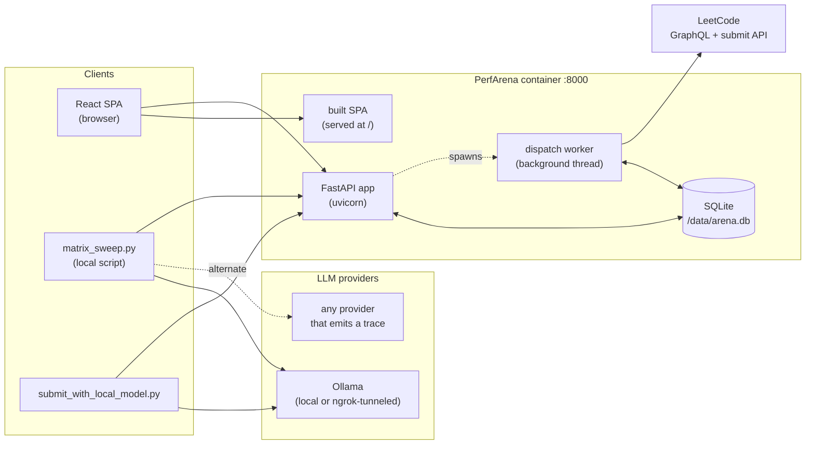
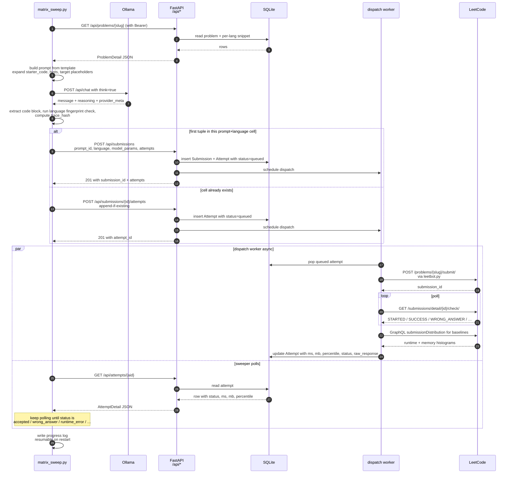
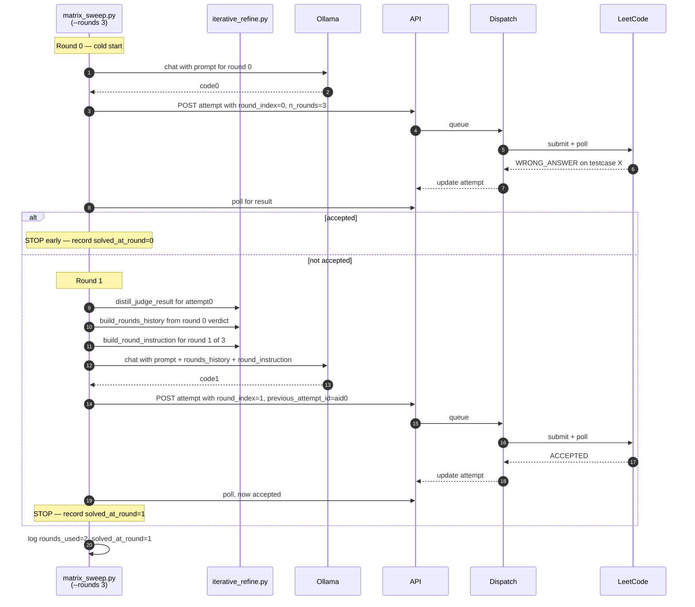
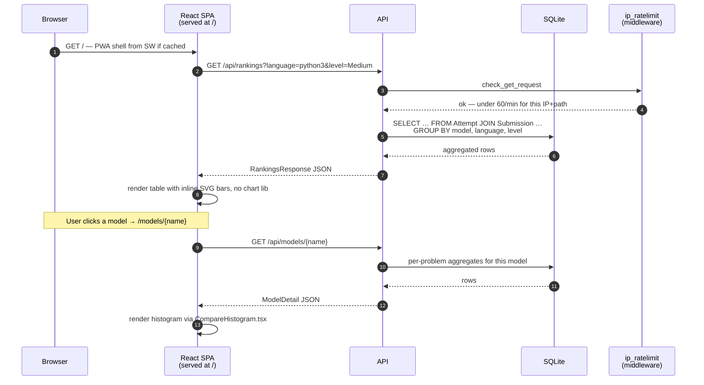
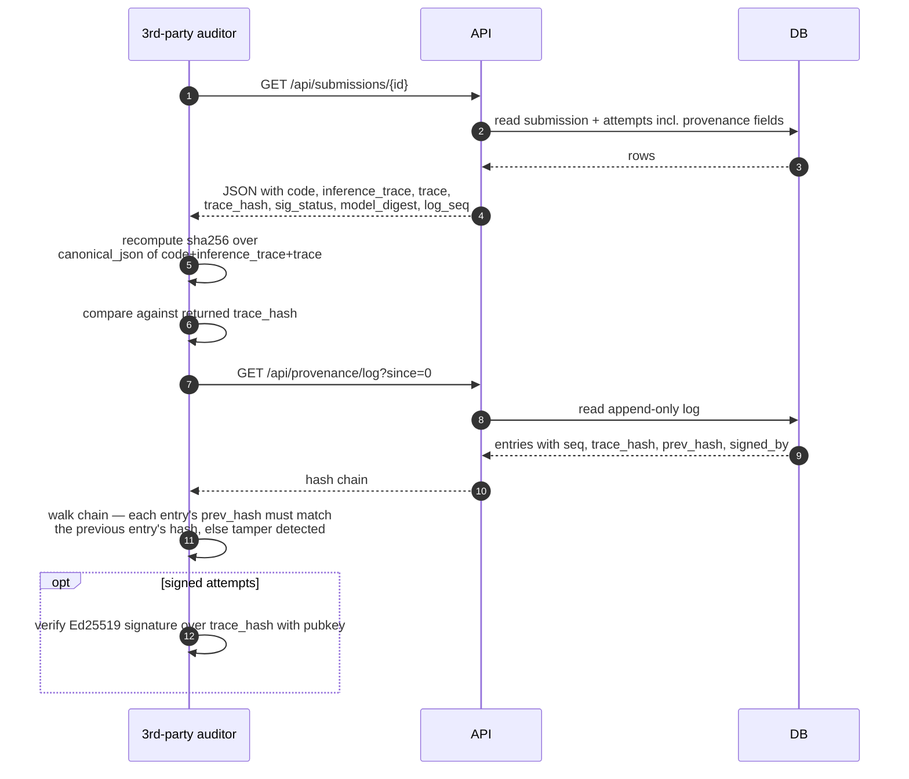

# Architecture

This file shows how the parts of PerfArena work together. The sequence diagrams show the `leetcode` harness, where the LeetCode judge checks and measures each solution. With a local harness such as `arena-linux-local`, the dispatch worker first sends the solution to the correctness oracle, and then sends it to the harness runner on the measurement host (see [`deployment.md`](deployment.md), section 3).

## Architecture

PerfArena is a **single-container web app** (FastAPI serves both `/api/*` and the built React SPA) with a **persistent SQLite database** and an **async dispatch worker** that calls LeetCode through `leetbot.py`. External population scripts (`matrix_sweep.py`, `submit_with_local_model.py`) talk to the same public HTTP API real users do.

**Key boundary properties:**

- **`/api/*`** is the **only contract** between population scripts and the platform. The sweep doesn't touch the DB; the DB doesn't touch the LLM.
- **Dispatch is async** — `POST /api/submissions/{id}/attempts` returns immediately with `queued`/`dispatching`; results land via polling `GET /api/attempts/{aid}`.
- **Migrations are additive-only** — `db.py:_ADDITIVE_COLUMNS` adds new columns on boot, never drops data. Re-deploys preserve the DB.
- **Rate limiting** has two layers: per-(IP, endpoint) GETs (default 60/min, see `ip_ratelimit.py`) and per-user submission cooldown + daily cap (see `ratelimit.py`).
- **Provenance** is a SHA-256 hash chain (`provenance.py`) of `(code, inference_trace, trace)`; clients can optionally Ed25519-sign each leaf.

## End-to-end workflows

### Population: matrix sweep → ranked leaderboard

Single-shot mode (`--rounds 1`, the default). Each `(prompt, language, problem)` tuple is one attempt.

After every attempt resolves, aggregates are derived on read:

- **Per-attempt aggregate** — `best_runtime_ms`, `best_memory_mb`, `best_runtime_percentile`, etc. over its retries.
- **Leaderboard** — `pass@k`, mean best runtime, mean best memory, mean best percentile, per (model, language, level).
- **Per-problem comparison** — bar widths scaled as `(min / value) × track_width` so the winner fills the track; bigger bar = better on every metric.

### Iterative refinement (multi-round) sweep

`--rounds N` (N>1) uses the `iterative-refine[-with-history][-with-shape]` prompt family. Round 0 is the cold attempt; rounds 1..N-1 are generated with `{{rounds_history}}` containing the previous judge verdict.

**Why rounds aren't just pass@k:** pass@k samples k *independent* tries from the same prompt; rounds give the model the *judge's verdict on the previous try* so the next attempt can debug. The taxonomy lives in `iterative_refine.py` and is surfaced on the leaderboard as `solved_at_round` and `rounds_used`.

### Read path: user opens the leaderboard

### Provenance verification

Anyone can recompute the trace hash and walk the chain to detect tampering:

`canonical_json` is `json.dumps(obj, sort_keys=True, separators=(",",":"), ensure_ascii=False)` — reproduce it exactly or the hash won't match.
